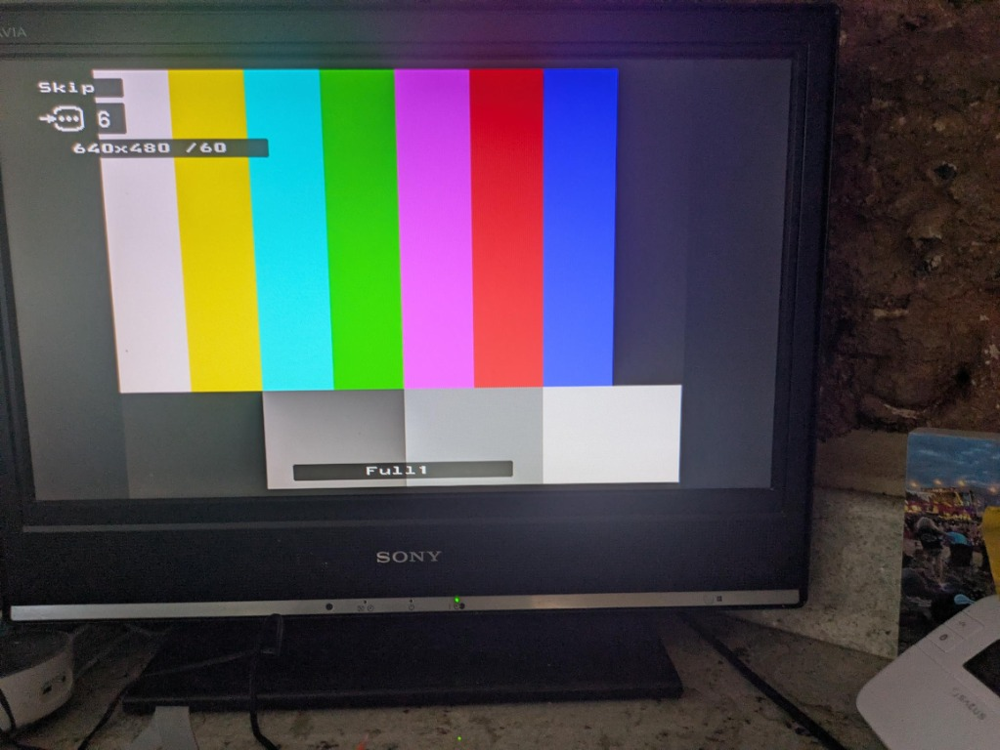

###############################
lib_vga: VGA display controller
###############################

************
Introduction
************

``lib_vga`` is a software VGA display controller for xcore.ai devices. A single thread
drives industry standard 640x480 @ 60 Hz VGA signalling (hsync, vsync and RGB pixel data)
directly from xcore ports, streaming pixels from a frame buffer in memory.

While VGA is now a legacy standard and modern displays may lack a native VGA input,
VGA to HDMI adapters are commercially available at very low cost, making this a simple
and inexpensive way to add display output to an xcore.ai system.

The controller uses timed port outputs and a buffered RGB port so that sync edges and
pixel data are placed with single pixel-clock accuracy, independent of thread scheduling.
A simple resistor DAC connected to the RGB port is all the external hardware required.

.. note:: The pixel clock is divided down from the xcore 100 MHz reference clock and is
   therefore exactly 25.000 MHz, rather than the nominal 25.175 MHz of the VGA standard.
   This is convenient as 25 MHz scales directly from the 100 MHz reference clock with an
   integer divide, requiring no additional clock resources. All timing scales
   accordingly: the horizontal rate is 31.25 kHz instead of 31.469 kHz and the frame
   rate is 59.52 Hz instead of 59.94 Hz - about 0.7% slower than nominal. This deviation
   is well within the tolerance of displays in practice, which lock to the signal and
   report it as 640x480 @ 60 Hz. If a precise pixel clock is needed, the on-chip
   application PLL could be configured to provide an exact 25.175 MHz timing reference
   instead.

Two frame buffer resolutions are supported:

* ``VGA_640_480`` - one frame buffer pixel per displayed pixel.
* ``VGA_320_240`` - each pixel is displayed twice horizontally and each line twice
  vertically, quartering the frame buffer size and bandwidth.

The pixel format is selected by the width of the RGB port:

.. list-table::
   :header-rows: 1

   * - Port width
     - Format
     - Layout (MSB first)
   * - 4 bits
     - IRGB (CGA style)
     - I, R, G, B
   * - 8 bits
     - RGB332
     - RRRGGGBB
   * - 16 bits
     - RGB565
     - RRRRRGGGGGGBBBBB

Pixels are packed little-endian into 32-bit frame buffer words, so each word holds
8, 4 or 2 pixels respectively.

Accessing the library software
==============================

There are three ways to access the software in this library:

- Include ``lib_vga`` in your CMakeLists.txt xcommon cmake modules list (see :ref:`Usage <usage>`).
- Directly clone the Git repository from `XMOS GitHub <https://github.com/xmos>`_.
- Download the latest release ZIP package from the `XMOS Website <https://www.xmos.com/libraries/>`_ and extract it to a chosen sandbox directory.

The ZIP file download is the recommended option for most users, as it is a quick way to get started with the library.

.. _usage:

*****
Usage
*****

``lib_vga`` is intended to be used with the `XCommon CMake <https://www.xmos.com/file/xcommon-cmake-documentation/?version=latest>`_
, the `XMOS` application build and dependency management system.

To use this library in an application include ``lib_vga`` in the application's ``APP_DEPENDENT_MODULES`` list in
`CMakeLists.txt`, for example:

.. code-block:: cmake

    set(APP_DEPENDENT_MODULES "lib_vga(0.1.0)")

All ``lib_vga`` functions can be accessed via the ``vga.h`` header file, for example:

.. code-block:: C

    #include "vga.h"

The controller runs forever on its own thread. Fill in a ``vga_config_t`` with the
sync and RGB ports, a free clock block and the resolution, then start
``vga_controller`` alongside the application code:

.. code-block:: C

    vga_config_t config = {
        .resolution = VGA_640_480,
        .p_hsync = XS1_PORT_1A,
        .p_vsync = XS1_PORT_1B,
        .p_rgb = XS1_PORT_8A,
        .clk_bit = XS1_CLKBLK_1,
        .frame_ptr_base = NULL
    };

    PAR_JOBS(
        PJOB(vga_controller, (&config)),
        PJOB(application, (&config))
    );

There is no separate colour depth setting: the width of the port passed as ``p_rgb``
automatically selects it. In the example above, the 8-bit ``XS1_PORT_8A`` selects
8 bpp RGB332; using a 4-bit port would select 4 bpp IRGB and a 16-bit port 16 bpp
RGB565.

The screen remains black until the application sets ``config.frame_ptr_base`` to a
word-aligned frame buffer. The frame buffer line stride is always
``vga_words_per_line(VGA_H_ACTIVE, bpp)`` words, i.e. 640 pixels worth of data per
line. At ``VGA_640_480`` the buffer must hold ``VGA_V_ACTIVE`` (480) lines. At
``VGA_320_240`` the controller displays the top-left quarter of a full 640x480 buffer:
only the first 320 pixels of each of the first 240 lines are shown, so the buffer
needs just 240 lines (the second half of each line is padding).

The required allocation is given by the ``VGA_FRAME_BUFF_WORDS(resolution, bpp)``
macro as a count of ``uint32_t`` words, or by ``VGA_FRAME_BUFF_SIZE(resolution, bpp)``
in bytes. Both evaluate to constant expressions when given constant arguments, so a
frame buffer may be declared statically:

.. code-block:: C

    // Statically declared frame buffer (word aligned by virtue of its type)
    uint32_t frame_buff[VGA_FRAME_BUFF_WORDS(VGA_320_240, 8)];

    // Or allocated dynamically
    uint32_t *frame_buff = malloc(VGA_FRAME_BUFF_SIZE(VGA_320_240, 8));

The resulting sizes
are:

.. list-table:: Frame buffer size requirements
   :header-rows: 1

   * - Resolution
     - Colour depth
     - Line stride
     - Lines
     - Buffer size
   * - 640x480
     - 4 bpp
     - 320 bytes
     - 480
     - 153,600 bytes (150 KiB)
   * - 640x480
     - 8 bpp
     - 640 bytes
     - 480
     - 307,200 bytes (300 KiB)
   * - 640x480
     - 16 bpp
     - 1280 bytes
     - 480
     - 614,400 bytes (600 KiB) \*
   * - 320x240
     - 4 bpp
     - 320 bytes
     - 240
     - 76,800 bytes (75 KiB)
   * - 320x240
     - 8 bpp
     - 640 bytes
     - 240
     - 153,600 bytes (150 KiB)
   * - 320x240
     - 16 bpp
     - 1280 bytes
     - 240
     - 307,200 bytes (300 KiB)

.. note:: \* At 640x480 with 16 bpp the frame buffer is larger than the 512 KiB of
   internal SRAM on an xcore.ai tile, so this combination is not usable with a single
   full frame buffer stored in tile memory. All other combinations fit, leaving the
   remainder of the tile memory for the application.

Frame buffer swapping
=====================

``frame_ptr_base`` is declared ``volatile`` and is re-read by the controller exactly
once per frame, during the vertical blanking interval just before the active video of
the next frame begins. The whole of each frame is then streamed from that single
pointer value, so an update can never take effect part way down the screen and no
tearing is possible.

Every buffer assigned to ``frame_ptr_base`` must be 32-bit word aligned. Buffers
declared as ``uint32_t`` arrays or obtained from ``malloc``/``calloc`` naturally meet
this requirement; the controller asserts the alignment of the first buffer at
start-up.

Because updating the pointer is a single atomic word write, the application is free to
choose its own buffering scheme:

* **Single buffer** - draw directly into the displayed buffer. Simple, but drawing is
  visible as it happens.
* **Double buffering** - draw into an off-screen buffer, then set ``frame_ptr_base``
  to it; the swap takes effect at the next frame boundary. Drawing of the following
  frame should not begin until the controller has moved off the old buffer, i.e. wait
  for the next vertical blanking (one frame period) before reusing it.
* **Triple buffering** - with three buffers the application can always draw
  immediately into a buffer that is neither displayed nor queued for display, at the
  cost of one extra buffer of memory and up to one frame of extra latency.

The controller does not signal vertical blanking back to the application, so an
application that needs to synchronise to it (e.g. to know when a swapped-out buffer
is free for reuse) should track frame timing itself, for example with a timer of one
frame period started at the point ``frame_ptr_base`` is updated.

****************************
Performance and thread speed
****************************

The controller runs on a single thread and uses timed, buffered port outputs, so the
thread's only hard real-time duty is to keep the RGB port's 32-bit transfer register
filled during active video - one ``OUT`` per 32-bit word of pixels. The sync outputs
are scheduled on port timers and place no load on the thread during a line.

On xcore.ai a thread is guaranteed a minimum of 600/8 = **75 MHz** when all 8 threads
of a tile are active (rising to 120 MHz with 5 or fewer active threads). The library
is tested at this worst case: stress tests run the controller alongside 7 busy
threads and verify both the output waveform and the remaining headroom on every
transfer register refill. The measured worst-case margins per output word are:

.. list-table:: Worst-case refill margin with the controller thread at 75 MHz
   :header-rows: 1

   * - Resolution
     - Colour depth
     - Word period
     - Minimum margin
   * - 640x480
     - 4 bpp
     - 320 ns
     - 245 ns
   * - 640x480
     - 8 bpp
     - 160 ns
     - 82 ns
   * - 640x480
     - 16 bpp
     - 80 ns
     - not met \*
   * - 320x240
     - 4 bpp
     - 640 ns
     - 562 ns
   * - 320x240
     - 8 bpp
     - 320 ns
     - 242 ns
   * - 320x240
     - 16 bpp
     - 160 ns
     - 75 ns

.. note:: \* 640x480 at 16 bpp is the one exception: its 80 ns word period cannot be
   sustained at 75 MHz. It is verified with the controller thread at 120 MHz (5 or
   fewer active threads on the tile), where the worst-case margin is 27 ns. In
   practice this mode is already limited by memory, as its frame buffer exceeds the
   tile SRAM (see the frame buffer size table above).

In summary, every mode except 640x480 16 bpp may share a tile with 7 other fully
loaded threads; no thread priority configuration is required.

********
Hardware
********

The only external hardware required is a resistor DAC between the xcore ports and the
VGA connector. Each colour channel is driven through a binary weighted resistor ladder:
one series resistor per bit, with the most significant bit through the smallest resistor
and each less significant bit through double the resistance of the bit above it. The
resistors of a channel sum into the monitor's 75 ohm colour input, which performs the
digital to analogue conversion.

This arrangement follows the `vga666` DPI/VGA adapter for the Raspberry-Pi
(G.J. van Loo, Fen Logic Ltd., 2014), whose design data is freely available at
`github.com/fenlogic/vga666 <https://github.com/fenlogic/vga666>`_.

Resistor values
===============

A VGA colour input is 75 ohms to ground and expects 700 mV at full scale. Driving it
from 3.3 V pads, the total series resistance of a channel must be:

   Rs = (3.3 / 0.7) x 75 - 75 = 279 ohms

For a channel with ``n`` bits the per-bit resistors are placed in parallel, so the most
significant bit resistor is:

   x = Rs x (2 - 2^(1 - n))

with each less significant bit using double the value of the one above. The table below
gives the calculated values for each channel width, together with the nearest standard
E96 (1%) values. Exact values are hard to obtain; rounding slightly changes the
full-scale amplitude but works well in practice. Use 1% resistors - colour accuracy
depends directly on how well matched the ladder is, and matters most for the most
significant bits.

.. list-table:: Per-channel resistor values by bit width (MSB first)
   :header-rows: 1

   * - Bits per channel
     - Calculated (ohms)
     - Nearest E96 values (ohms)
   * - 1
     - 279
     - 280
   * - 2
     - 418, 836
     - 422, 845
   * - 3
     - 488, 975, 1950
     - 487, 976, 1.96k
   * - 4
     - 522, 1045, 2090, 4180
     - 523, 1.05k, 2.1k, 4.22k
   * - 5
     - 540, 1080, 2159, 4318, 8637
     - 536, 1.07k, 2.15k, 4.32k, 8.66k
   * - 6
     - 548, 1097, 2194, 4387, 8775, 17549
     - 549, 1.1k, 2.21k, 4.42k, 8.87k, 17.8k

The channel widths, and so the number of resistors needed, depend on the colour depth:

.. list-table::
   :header-rows: 1

   * - Format
     - Bits per channel
     - Resistors
   * - 16 bpp RGB565
     - R: 5, G: 6, B: 5
     - 16
   * - 8 bpp RGB332
     - R: 3, G: 3, B: 2
     - 8
   * - 4 bpp IRGB
     - 2 per channel (see below)
     - 6

In IRGB mode each colour channel is effectively a 2-bit DAC: the channel's colour bit
carries the most significant weight and the shared intensity bit the least. Each of the
R, G and B pins therefore connects to its channel through the most significant resistor,
while the I pin fans out to *all three* channels, each through the second most
significant resistor. Round values such as 500 ohm (colour) and 1k (intensity) also work
well here. This arrangement reproduces the CGA levels 0, 0x55, 0xAA and 0xFF generated
by the example application's pixel packing.

Sync signals
============

Hsync and vsync connect directly to the VGA connector through small series resistors.
Their values were determined empirically in the `vga666` design: 100 ohms is known to
work, whereas 200 ohms failed on some monitors.

The library configures the pad drive strengths automatically: the RGB port pads are
driven at 12 mA and the sync pads at 4 mA.

*******************
Example application
*******************

The ``examples/app_vga`` application displays colour bars over the top three quarters
of the screen with a greyscale ramp below. The ports and resolution used are set by
the ``-D`` definitions in the example's ``CMakeLists.txt``.

   The example application output (320x240, 4 bpp IRGB) on a monitor, which reports
   the signal as 640x480 @ 60 Hz due to the pixel doubling applied by the library.

Building the example
====================

This section assumes that the `XMOS XTC Tools <https://www.xmos.com/software-tools/>`_ have been
downloaded and installed. The required version is specified in the accompanying ``README``.

Installation instructions can be found `here <https://xmos.com/xtc-install-guide>`_.

Special attention should be paid to the section on
`Installation of Required Third-Party Tools <https://www.xmos.com/documentation/XM-014363-PC/html/installation/install-configure/install-tools/install_prerequisites.html>`_.

The application is built using the `xcommon-cmake <https://www.xmos.com/file/xcommon-cmake-documentation/?version=latest>`_
build system, which is provided with the XTC tools and is based on `CMake <https://cmake.org/>`_.

The ``lib_vga`` software ZIP package should be downloaded and extracted to a chosen working
directory.

To configure the build, the following commands should be run from an XTC command prompt:

.. tab:: Windows

    .. code-block:: console

        cd lib_vga\examples\app_vga
        cmake -G "Unix Makefiles" -B build

.. tab:: MacOS and Linux

    .. code-block:: console

        cd lib_vga/examples/app_vga
        cmake -G "Unix Makefiles" -B build

If any dependencies are missing they will be retrieved automatically during this step.

The application binaries should then be built using ``xmake``:

.. code-block:: console

    xmake -j -C build

Binary artifacts (.xe files) will be generated under the appropriate subdirectories of the
``bin`` directory in the ``app_vga`` directory.

For subsequent builds, the ``cmake`` step may be omitted.
If ``CMakeLists.txt`` or other build files are modified, ``cmake`` will be re-run automatically
by ``xmake`` as needed.

Running the example
===================

.. tab:: Windows

    From an XTC command prompt, the following command should be run from the ``examples\app_vga``
    directory:

    .. code-block:: console

        xrun .\bin\app_vga.xe

    Alternatively, the application can be programmed into flash memory for standalone execution:

    .. code-block:: console

        xflash .\bin\app_vga.xe

.. tab:: MacOS and Linux

    From an XTC command prompt, the following command should be run from the ``examples/app_vga``
    directory:

    .. code-block:: console

        xrun ./bin/app_vga.xe

    Alternatively, the application can be programmed into flash memory for standalone execution:

    .. code-block:: console

        xflash ./bin/app_vga.xe

*******
Testing
*******

The ``tests`` directory contains a pytest based regression test. For each supported
resolution and colour depth a test application fills the frame buffer with a known
pattern, is simulated under ``xsim`` with VCD tracing and the resulting trace is checked
by ``vga_tb.py`` for pixel clock frequency, hsync/vsync timing, RGB data correctness
(including blanking) and output thread timing headroom. The tests build the applications
with shortened frame timings so that several whole frames can be simulated quickly.

In addition:

* **Stress tests** rerun each configuration with the tile fully loaded (8 active
  threads), so the controller runs at the minimum guaranteed 75 MHz; 640x480 16 bpp
  is instead tested with 5 active threads (120 MHz), the fastest thread speed on
  xcore.ai. The headroom check verifies every transfer register refill met its
  deadline.
* **A full-timing test** simulates ~1.3 frames of the real, unshortened
  640x480 @ 60 Hz timing to exercise the production divider values and the port
  timer wrap arithmetic.
* **A buffer swap test** swaps ``frame_ptr_base`` between two distinctly patterned
  buffers at slightly more than the frame rate; the test bench verifies that every
  displayed frame comes entirely from a single buffer (no tearing is possible) and
  that both buffers appear.

To run the tests:

.. code-block:: console

    cd tests
    pip install -r requirements.txt
    pytest

*************
API Reference
*************

.. doxygenenum:: vga_resolution_t

.. doxygenstruct:: vga_config_t
   :members:

.. doxygendefine:: VGA_FRAME_BUFF_WORDS

.. doxygendefine:: VGA_FRAME_BUFF_SIZE

.. doxygendefine:: VGA_H_ACTIVE

.. doxygendefine:: VGA_H_FRONT

.. doxygendefine:: VGA_H_SYNC

.. doxygendefine:: VGA_H_BACK

.. doxygendefine:: VGA_H_TOTAL

.. doxygendefine:: VGA_V_ACTIVE

.. doxygendefine:: VGA_V_FRONT

.. doxygendefine:: VGA_V_SYNC

.. doxygendefine:: VGA_V_BACK

.. doxygendefine:: VGA_V_TOTAL

.. doxygenfunction:: vga_pixels_per_word

.. doxygenfunction:: vga_words_per_line

.. doxygenfunction:: vga_port_width_bits
